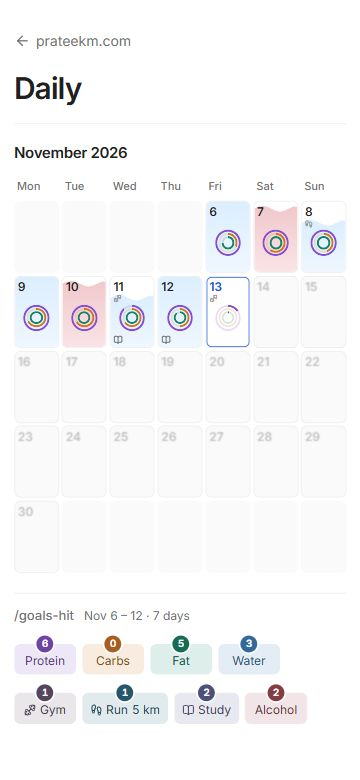
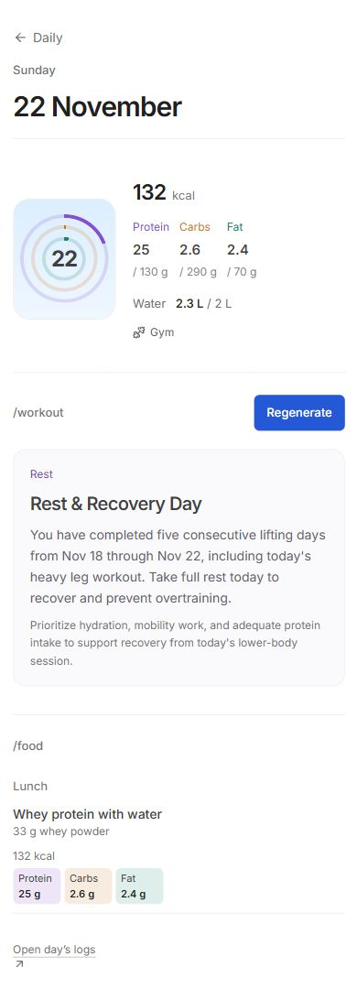
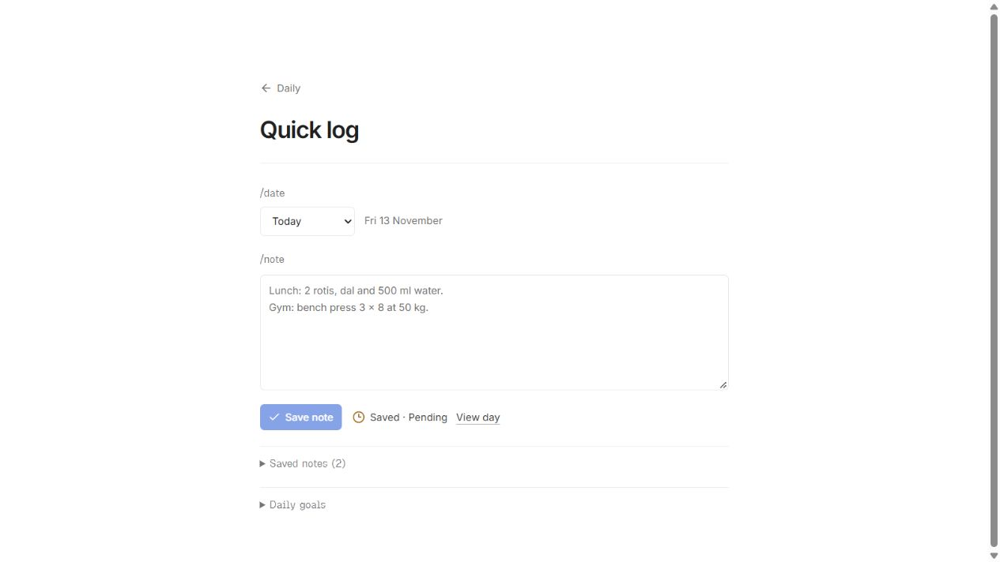

# Habit: Minimal daily goal tracker

Write what you ate, drank, or did in one note. Habit puts your macros, water, workouts, and study on a calendar. Open a day for the details or check how often you hit your goals at the bottom of the month.

[Live demo at prateekm.com/daily](https://prateekm.com/daily)





## Set up Habit with an AI tool

If Git and the terminal are new to you, paste this into an AI coding tool that can run commands on your computer.

> Read https://github.com/pr4733k/habit/blob/main/README.md and help me run Habit on this computer. I’m new to Git and the terminal.
>
> Check what’s already installed, then follow the local setup steps. Run the commands you can. If I need to do something myself, give me one step at a time. Let me enter my password on this computer and keep it out of the chat.
>
> Help me configure a dedicated OpenRouter key in the private configuration file without printing or sending it in chat. Use a $5 monthly spending limit. Check that a note processes automatically and that the calendar and quick log open. Give me their links and tell me how to start Habit again later. Keep the setup local and skip Android.

## Run it locally

Use Node.js 20 (20.19 or later) or 22.12+, npm, and PHP 8.2+ with PDO SQLite, cURL and mbstring enabled.

```sh
git clone https://github.com/pr4733k/habit.git
cd habit
npm ci
```

Choose a password. This creates a blank SQLite database and a separate token for processing notes. `DAILY_TIMEZONE` is optional and defaults to `UTC`.

```sh
DAILY_LOG_PASSWORD='choose-a-password' DAILY_TIMEZONE='Europe/London' php scripts/daily-local.php
```

In PowerShell, set `$env:DAILY_LOG_PASSWORD` and, if you want, `$env:DAILY_TIMEZONE` before running `php scripts/daily-local.php`.

Run `npm run api` in one terminal and `npm run dev` in another. Open [the calendar](http://127.0.0.1:5173/daily) or [quick log](http://127.0.0.1:5173/log). Set your targets under **Daily goals**. A change takes effect today and keeps the goals attached to earlier dates.

## Process notes automatically

OpenRouter is the recommended processor. Add a dedicated API key to the ignored .daily-data/config.php file, set processor to openrouter, and keep the key out of chat and Git. Use a $5 monthly key limit. Install PHP cURL and mbstring as well as PDO. The default model is google/gemini-3.8-flash.

Notes save immediately. The server calculates their entries in the background, and the log shows Logged when processing finishes. Water-button taps and clear water-only notes do not use AI. If a note fails after three attempts, use Retry beside it. Use Edit to correct an earlier note.

On hosted installs, schedule the recovery worker every minute. See [OpenRouter setup](daily/openrouter.md) for configuration, the worker command and food references. Existing installs keep their current processing mode until you change it.

The /today page on your install shows the day’s entries and a saved workout suggestion. Unlock your log to see Generate workout. Configure your training goals, available time and recurring sessions before using suggestions. A suggestion never counts as a completed workout.

### Codex or your own processor (optional)

Set processor to external and follow [the note processing steps](daily/processor.md). The existing pending and commit API remains available. For the optional PC bridge, enable auto_sync and run node scripts/daily-bridge.mjs /path/to/codex YOUR_HABIT_CHAT_UUID. Keep the bridge and Codex open. This mode needs your computer; OpenRouter mode does not.

## Host it

For a local build, run `npm run build` and `npm run serve`, then open `http://127.0.0.1:8080`. The development commands use port 8877 for the API. If you use the built site for processing, set the URL in `.daily-data/processor.json` to `http://127.0.0.1:8080/daily/api.php`.

For an HTTPS deployment on Apache, run `npm run build` and copy `dist/`, including the `.htaccess` files, into your document root. Run [the schema](daily/schema.sql) in a MySQL or MariaDB database. Copy [the example config](daily/config.example.php) to `daily-config.php` **above** the document root and fill it in. You can also set `DAILY_CONFIG` to its absolute path.

Generate a password hash with `php -r 'echo password_hash(getenv("DAILY_LOG_PASSWORD"), PASSWORD_DEFAULT), PHP_EOL;'` and a session key with `php -r 'echo bin2hex(random_bytes(32)), PHP_EOL;'`. Generate a separate token for the processor the same way and put its SHA-256 hash in `sync_token_hash`. Store the original token and your HTTPS `/daily/api.php` URL in the local `.daily-data/processor.json` file.

The calendar and quick log require the password by default. Set `public_calendar` to `true` if you want anyone with the link to see your processed entries. Raw notes stay behind the password.

## Android widget (optional)

Private logging includes **Repeat meal** above the note box and **Nutrition label** beside it. Repeating a meal reuses the same portion and macros without AI. Label photos offer camera/gallery selection, show the extracted values, and require an amount eaten before saving. Images are sent to OpenRouter and are not stored on your server. PHP GD is required for photo processing.

The Workout tab, native exercise editor, and taller widget show progression cues based on completed sets. Cues never overwrite your prefilled weights or treat a planned workout as completed.

The app opens your Habit website with its calendar, Workout tab, and daily logs. The widget shows macros, water, and an exercise queue when resized taller. Log the displayed previous sets in one tap, or edit weights, reps, and set groups in a native popup. Each exercise saves separately. Pending exercise saves stay on the phone and retry when connected.

Tap **+** beside Water to add 100 mL without AI. **Add a note** opens a text box and uses the same processing queue as the web form. The widget refreshes after your saves; Android may delay background checks for changes made on another device. Tap the refresh icon to request an update now.

If you already host Habit, rebuild and deploy the latest code to enable the water button.

1. On Android 8 or later, download [Habit.apk from GitHub Releases](https://github.com/pr4733k/habit/releases/latest/download/Habit.apk) and open it. If Android asks, allow the app that opened the APK to install it.
2. Open **Habit** and enter your own Habit site’s HTTPS address and the password you use at `/log`. The phone needs to be able to reach that address. A site running at `127.0.0.1` on your computer is only available on that computer.
3. Touch and hold an empty spot on your home screen, choose **Widgets → Habit**, and drag the widget into place. Drag its resize handles for a larger workout view. To change sites, open Habit and tap **Connection**.

If you want help with the widget, paste this separate prompt into your AI tool.

> I already have Habit and want to add the Android widget. Read https://github.com/pr4733k/habit#android-widget-optional and show me where to download the APK and how to add the widget.
>
> Help me check that my phone can open my Habit site over HTTPS. If Habit only runs on localhost, explain how I can make it reachable and ask before changing my hosting or network settings.
>
> Let me enter my password on the phone. Show me how to refresh the widget and save a note.

See [the Android build instructions](android/README.md) to build the widget from source. The code is available under the [MIT license](LICENSE). The screenshots show the live demo.
